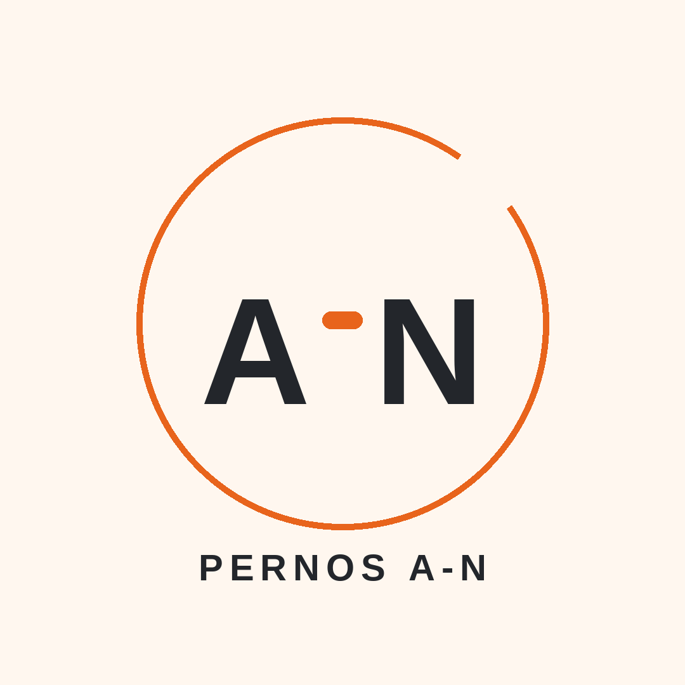

<p align="center">
  
</p>

<h1 align="center">Pernos A-N</h1>

<p align="center">
  <strong>Pernos de enganche fabricados a mano en Ayacucho, Buenos Aires.</strong><br />
  Acero SAE 1045 · Arandela de apoyo · Alfiler de seguridad
</p>

<p align="center">
  <a href="https://www.instagram.com/pernos.a.n/">Instagram</a> ·
  Ventas por Mercado Libre ·
  Envíos a todo el país
</p>

---

## Descripción

Landing pública de **Pernos A-N**, un taller que fabrica a mano pernos de enganche
para camioneta, auto y tractor. La página funciona como enlace de la bio de Instagram:
el visitante entra desde el celular, elige su modelo y compra directo en Mercado Libre.

Es un sitio de una sola pantalla, liviano y pensado mobile-first. Cada tarjeta muestra
la infografía del modelo y un botón que lleva a su publicación de Mercado Libre.

## Stack

- **[Vite](https://vitejs.dev/) + [TypeScript](https://www.typescriptlang.org/)** — sin frameworks, carga mínima.
- **HTML y CSS puros** — interfaz liviana y rápida.
- **[Vercel](https://vercel.com/)** — despliegue continuo desde este repositorio.

## Desarrollo local

Requiere Node.js 18 o superior.

```bash
npm install     # instala dependencias
npm run dev     # levanta el servidor de desarrollo
npm run build   # genera la versión de producción en dist/
npm run preview # previsualiza la build de producción
```

## Estructura

```
pernos-a-n/
├── index.html              # Encabezado, grilla de productos y pie
├── public/img/             # Infografías de cada modelo y el logo
└── src/
    ├── data/productos.ts   # Catálogo: medida, precio, imagen y link de Mercado Libre
    ├── main.ts             # Genera las tarjetas a partir del catálogo
    └── style.css           # Estilos
```

El catálogo vive en un único archivo (`src/data/productos.ts`). Para actualizar un precio,
una imagen o un enlace, se edita ese archivo y el cambio se refleja en toda la página.

## Despliegue

El sitio se despliega automáticamente en Vercel al importar este repositorio: Vercel
detecta Vite sin configuración adicional y publica cada push a `main`.

---

<p align="center">
  Hechos a mano en Ayacucho, Buenos Aires 🇦🇷
</p>
